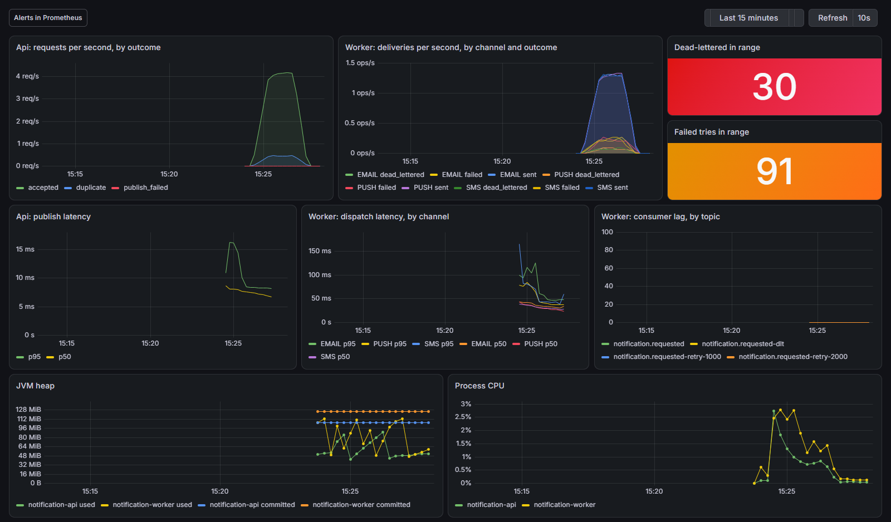

# Notification Platform

An event-driven notification system: an HTTP ingress accepts requests, publishes them to
Kafka, and a worker consumes, dispatches and records them.

Spring Boot 4.1 / Java 21 / Kafka / Redis / MySQL, as a Maven multi-module build. It is
deliberately a *platform* rather than a service: two deployables that scale and fail for
different reasons, which is the point of the exercise.

## Modules

| Module | What it is |
|---|---|
| `notification-common` | The wire contract: event records, channel enum, topic names. No dependencies, not even Spring. |
| `notification-api` | Write-only ingress on :8080. Validates, derives the event id from `Idempotency-Key`, publishes, and remembers the key in Redis for the replay answer. Owns no tables. |
| `notification-worker` | Consumer on :8081. Dispatches through a channel abstraction, owns the schema and serves the delivery reads and metrics. |

## Running it

```bash
docker compose up --build
```

Brings up Kafka, Redis, MySQL and both applications, with Prometheus and Grafana over them
(see [Observability](#observability)). Then, from
`http/notification-platform.http` (select the `dev` environment), or by hand:

```bash
TOKEN=$(curl -s -X POST localhost:8080/api/auth/token -H 'Content-Type: application/json' \
  -d '{"clientId":"notification-client","clientSecret":"dev-secret"}' | jq -r .accessToken)

curl -s -X POST localhost:8080/api/notifications \
  -H "Authorization: Bearer $TOKEN" -H 'Content-Type: application/json' \
  -H 'Idempotency-Key: demo-1' \
  -d '{"recipientId":"user-42","destination":"jason@example.com","channel":"EMAIL",
       "templateKey":"order-shipped","payload":{"orderId":"A-1001"}}'

# the id comes back from the POST; the status read is on the worker, not the api
curl -s localhost:8081/api/notifications/<eventId> -H "Authorization: Bearer $TOKEN"
```

Sending the same `Idempotency-Key` again returns the same event id with `"duplicate": true`.
A 5xx means the publish was not confirmed, not that it failed: retry under the same key and
the worker absorbs any copy that did get through. Keys must be unique per notification
([ADR 0006](docs/adr/0006-delivery-guarantees.md)).

The EMAIL channel really sends: the compose stack runs a mail catcher, and the rendered
message is waiting at http://localhost:8025.

That token carries both scopes the platform enforces: `notifications.write` for the write on
the api, `notifications.read` for the status read on the worker. A token that authenticates
but lacks the scope a route asks for gets a 403.

Swagger UI (dev profile only): http://localhost:8080/api/swagger-ui.html

## Reading deliveries

Everything about a delivery is read from the worker on :8081, with a `notifications.read`
token. Statuses are `PENDING`, `SENT`, `RETRYING` (a try failed, the retry topics hold
another), `FAILED` (the last try failed, on its way to the dead-letter topic) and
`DEAD_LETTERED` (parked).

```bash
# a page, newest first by last update; every filter is optional, page is 0-based,
# size defaults to 20 and is capped at 100
curl -s 'localhost:8081/api/notifications?status=DEAD_LETTERED&channel=EMAIL&recipientId=user-42&page=0&size=20' \
  -H "Authorization: Bearer $TOKEN"

# counts by status and by channel over the last 24 hours, zeros included
curl -s localhost:8081/api/notifications/stats -H "Authorization: Bearer $TOKEN"

# one delivery and every attempt at it
curl -s localhost:8081/api/notifications/<eventId> -H "Authorization: Bearer $TOKEN"
```

The list carries fixed fields and an `attemptCount`, never the payload. The detail read
adds the attempts. [ADR 0005](docs/adr/0005-delivery-states-and-the-read-api.md) has the
reasoning.

Metrics are `notification.delivery` (a counter tagged `channel` and `outcome`: `sent`,
`failed`, `dead_lettered`) and `notification.dispatch.duration` (a timer tagged `channel`).
`/actuator/metrics` and `/actuator/prometheus` take the same read scope, on the api too;
`/actuator/health` is open. Compose scrapes them with a dev token it keeps fresh, below.

```bash
curl -s 'localhost:8081/actuator/metrics/notification.delivery?tag=outcome:failed' \
  -H "Authorization: Bearer $TOKEN"
```

## Observability

The same `docker compose up --build` starts Prometheus and Grafana. Once the images are
built (the first build downloads Maven's dependencies and takes longer), live graphs are two
steps away:

```bash
./observability/load.sh            # bash and curl
```

```powershell
.\observability\load.ps1           # Windows PowerShell
# if scripts are disabled: powershell -ExecutionPolicy Bypass -File .\observability\load.ps1
```

Then open http://localhost:3000. Grafana opens on the dashboard, with no login.



The load script gets a token with the dev credential above and sends 300 notifications,
200 ms apart, rotating the three channels. Every 10th repeats the one before it, so the api
answers it as a duplicate; every 20th names a template the worker does not have, so it fails
three tries and is dead-lettered. `COUNT` and `DELAY_SECONDS` (bash), or `-Count` and
`-DelayMs` (PowerShell), change the mix's length and pace.

| Metric | From | Tags | On the dashboard |
|---|---|---|---|
| `notification.ingress` | api | `outcome`: `accepted`, `duplicate`, `publish_failed` | requests per second |
| `notification.publish.duration` | api | none | publish p50/p95 |
| `notification.delivery` | worker | `channel`, `outcome`: `sent`, `failed`, `dead_lettered` | deliveries per second, the dead-lettered and failed counts |
| `notification.dispatch.duration` | worker | `channel` | dispatch p50/p95 |
| `kafka.consumer.fetch.manager.records.lag` | worker, bound by Boot | `topic`, `partition` | consumer lag |
| `jvm.memory.*`, `process.cpu.usage` | both | `area`, `id` on the memory ones | heap and CPU |

Every tag has a fixed set of values: no recipient, key or event id. The latency panels draw
only while there is traffic, since a quantile of no requests has no value.

Prometheus is on http://localhost:9090. Its six alert rules are in
`observability/prometheus/alerts.yml`, with promtool tests beside them, and show on
http://localhost:9090/alerts: a dead-lettered event, a high failure ratio, slow dispatch,
failing publishes, a target down and growing consumer lag. Nothing routes them anywhere:
compose runs no Alertmanager. The load script's dead-lettered events fire the first within
half a minute of parking (one scrape and one evaluation, 15s each).

Both apps' `/actuator/prometheus` take the read scope, so compose runs a small
`scrape-token` container that fetches a dev token, refreshes it every 30 minutes, and leaves
it in a volume Prometheus reads on every scrape. That is a dev arrangement and stays inside
compose: [ADR 0007](docs/adr/0007-scraping-inside-compose.md) has why it is not a
management port, and what a real deployment needs instead.

## Building

```bash
./mvnw clean install     # all three modules
./mvnw test              # unit tests, no Docker needed
./mvnw verify            # unit + *IT integration tests (needs Docker)
```

## Design decisions

The non-obvious ones are recorded in [`docs/adr/`](docs/adr/README.md):

- [0001](docs/adr/0001-three-modules-one-contract.md) — three modules: one contract jar, two deployables
- [0002](docs/adr/0002-kafka-over-jms.md) — Kafka, not JMS, for the event backbone
- [0003](docs/adr/0003-worker-owns-the-schema.md) — the worker owns the schema, and therefore the status read
- [0004](docs/adr/0004-the-provider-call-leaves-the-transaction.md) — the provider call leaves the transaction
- [0005](docs/adr/0005-delivery-states-and-the-read-api.md) — delivery states, the read api, and what the metrics expose
- [0006](docs/adr/0006-delivery-guarantees.md) — delivery guarantees: a derived event id, and keys recorded after the ack
- [0007](docs/adr/0007-scraping-inside-compose.md) — scraping inside compose: a refreshed dev token, not a management port

`CLAUDE.md` carries the working notes: commands, conventions, and the traps this stack has
already sprung.
